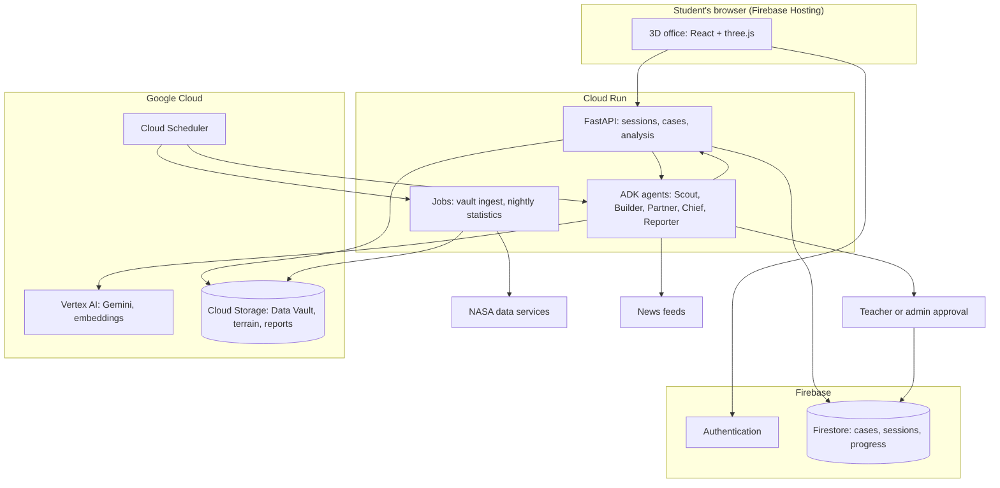

# Sarawak Earth Detectives: master sheet

> **Status:** finalised idea, v1.1 · 14 Nov 2026 (hackathon day 1) · Team SMILING FACE WITH SUNGLASSES
> **Track:** NASA Space Apps 2026, "Be An Earth System Trend Detective!"
> **This file is the single source of truth.** Sections 1 to 7 are the submission fields. Sections 8 to 22 are the build plan behind them.
> **Group Members:":** Nathan: CEO & CTO. Leader. Owns the product vision, data, ML, agents, frontend and backend.; Malcolm: CMO & CTO. Marketing and pitch, plus technical support. ;Zoe: CMO & Media. Marketing, video and visuals, including the more than/equal 30-second demo and slides.
> **Submission Deadline:** Start at 7:30a.m. MYT 14/11/2026, Submit by 9:00p.m. MYT 15/11/2026. 
> **Judging criteria (five, from the NASA Judging & Awards Guide and the SSC FAQ):** Influence/Impact: scale of the problem and how many people are helped.; Creativity: novel rather than incremental.; Validity: scientifically sound and able to work in the real world.; Relevance: responds to the chosen challenge, complete, technically feasible and usable.; Presentation: how well the team tells the challenge, the solution and why it matters.; Weights: not published. The SSC FAQ says presentation deserves equal attention to the solution itself, so we plan as if all five are equal.; Judging flow: local judges choose which projects advance to global judging and may give local prizes. Local and global winners can be different teams.
> **Mandatory technology:** no tech stack is mandated. Required: the project must use open data from NASA and/or its Space Agency Partners. Track brief requires the tool to let a user select Earth science variables, visualise how they change over time, and decide what, where and how much is changing and whether the change is “significant”. 
> **Submission rules:** demo of at most 30 seconds with English subtitles, or at most 7 slides. Public links with no login. All content in English. No recognisable under-18s. AI use must be disclosed, and AI images must be watermarked. No NASA logos in generated content.

**How to read the marks.** ✅ means the fact or link was checked at the source. ⚠️ means unchecked: confirm before it goes into the submission. No analysis has been run yet, so this sheet contains no findings, only the plan.

---

## 1. Project name

**Sarawak Earth Detectives**

One-liner: *A detective agency for students: an AI client brings you real cases about Sarawak's natural disasters and changing Earth, and you solve them with NASA satellite data.*

Slide line: *Real events. Real NASA data. You're the detective.*

## 2. Summary (about 150 words)

Students in Sarawak live through floods, haze and peat fires, yet they mostly learn about them from social media. Sarawak Earth Detectives turns those events into detective cases. An AI "client" watches the news and NASA's near-real-time data, and opens a case when an event can be investigated. The student enters a 3D detective office, visits the scene on a 3D model of Sarawak, picks evidence from decades of NASA Earth data, and tests whether the change is real or just one bad year. An AI partner gives hints but never the answer. The student writes the verdict, the system checks it against statistics computed in code, and a case report is produced. The platform does what the challenge asks (select variables, visualise change over time, measure the rate and test its significance) for the audience the challenge names: students. It matters because the people most affected by a changing Earth should be able to check it for themselves.

## 3. Project demonstration

`[YouTube link: to be added]`

Rules ✅: a video of **at most 30 seconds** with English subtitles, or a deck of at most seven slides in English. Going over makes the project ineligible for global judging. The link must open without a login.

## 4. Project

`[Prototype link: to be added]`

Rules ✅: the link must be publicly accessible with no password, permission or registration. The app must therefore open straight into the office, with sign-in happening silently.

---

## 5. Project details

### 5.1 What it does

Sarawak Earth Detectives is a web platform where a student plays a detective at an agency. Each case is a real event in Sarawak. Every case asks the same kind of question:

> **Is this getting worse, or was it just one bad year?**

That is a trend question, and it has a testable answer. To solve a case the student does the four things the challenge requires:

| The challenge asks | What the student does |
|---|---|
| Select variables | Chooses evidence cards from the Evidence Locker, and rejects the red herrings |
| Acquire data for a region | Visits the scene on the 3D map; the region's records are pulled from the Data Vault |
| Visualise change over time | Pins each record to the Evidence Board as a time series |
| Rate of change and significance | Uses the desk tools to remove the seasons, fit the trend and weigh the evidence |

### 5.2 How one investigation runs, start to finish

A case takes 15 to 20 minutes. It has seven beats. Each beat happens at a different station in the 3D office.

| # | Beat | Where in the office | What the student does | What the system does | Ends when |
|---|---|---|---|---|---|
| 1 | **The Call** | The desk. The phone rings, and a case folder slides across | Listens to the Client's brief, reads the news clipping, accepts the case | Loads the case pack: brief, region, evidence set, answer key | The student signs the case folder |
| 2 | **The Scene** | The map table: a 3D relief model of Sarawak | Flies to the location. Scrubs a time slider to watch satellite layers change. Drops up to three "clue pins" on things they notice | Shows NASA imagery and data layers over the terrain | At least one clue is pinned |
| 3 | **The Evidence Locker** | A cabinet of evidence cards | Picks three to five cards. Each card is one measurement with a plain definition and a mission badge. One or two cards are red herrings | Records the choices. The Partner asks "why this one?" if a red herring is picked | Three cards are chosen |
| 4 | **The Board** | The corkboard on the wall | Pins the cards. Each opens as a time series. Links cards with red string to say "these move together" | Draws each record from the Data Vault | Every chosen card has been opened |
| 5 | **The Lab** | Tools laid out on the desk | Uses the tools (below) on each record | Runs the statistics in code and returns a stamped result | Each record carries a stamp |
| 6 | **The Deduction** | The typewriter | Fills in the verdict: what is changing, where, by how much, is it real, and why it might be. Sets a confidence level | The Partner asks one challenge question. The student may revise once | The verdict is submitted |
| 7 | **Case Closed** | The Chief's stamp, then the filing shelf | Reads the feedback. Receives the case report and any badges | Grades the reasoning against the answer key. Builds the report. Files the case | The folder goes on the shelf |

**The desk tools (beat 5).** Each is a physical object the student picks up.

| Tool | What it does | What it teaches |
|---|---|---|
| **Magnifier** | Zooms a record in time | Look closely before judging |
| **Season filter** (a tinted lens) | Removes the yearly cycle | A wet season is not a trend |
| **Ruler** | Lays a trend line and reads the rate per decade, with its range | "How much" |
| **Scales** | Weighs the trend against the noise, using two tests | "Is it real" |
| **El Niño lamp** | Dims the El Niño years and re-tests | One strong year can fake a trend |
| **Twin map** | Puts two regions side by side | The same cause can give opposite trends |

**Result stamps.** *Significant*, *Not significant*, or *Needs more years* (with an estimate of how many).

**How a case can end.**

| Ending | Meaning | What happens |
|---|---|---|
| **Solved** | The verdict matches the evidence | Report issued, badges awarded |
| **Solved: not enough evidence** | The student correctly says the record can't settle it | Counts as a full win. This is the hardest and most valuable answer |
| **Sent back** | The verdict contradicts the student's own evidence | Feedback shows where; one retry |
| **Reopened** | New satellite data has arrived since the case closed | The Client calls again: "new evidence in an old case" |

**What is graded.** Reasoning, not speed.

| Part | Weight | Checked against |
|---|---|---|
| Evidence choice | 25% | Relevant cards chosen, red herrings rejected |
| Method | 25% | Seasons removed before testing; both tests run |
| Verdict | 30% | Direction, rate and significance agree with the computed answer |
| Explanation | 20% | The "why" is framed as a hypothesis, not a proven cause |

**Badges** reward good habits: *Clean Signal* (removed seasons first), *Red Herring* (rejected irrelevant evidence), *Honest Doubt* (correctly said "not enough evidence"), *Second Opinion* (ran both tests), *Twin Trail* (compared two regions), *El Niño Eye* (checked the El Niño effect). Ranks run from Trainee to Chief Inspector.

**The case report.** One page, written mostly by the student: their verdict in their own words, the key chart, the numbers with mission badges, a method box, the limits, and "what I'd investigate next". It can be shared with a teacher.

### 5.3 The two AI roles

| Role | Who they are in the story | What they actually do | Hard rules |
|---|---|---|---|
| **The Client** | A voice on the phone who brings cases | An agent that finds events, checks they can be investigated, and prepares the case | Never opens a case without human approval |
| **The Partner** | A hornbill perched by the desk | An assistant that knows the case and what the student has done so far | Gives hints in three steps (nudge, pointer, worked example). Never states the verdict. Never does the maths |

A third agent, **the Chief**, appears only at the end to grade and give feedback.

### 5.4 The interface: a detective's office, not a dashboard

The whole product is one 3D room. Charts exist, but they live on objects in the room.

| Element | Design |
|---|---|
| **The office** | A warm, low-poly room at dusk. Desk, corkboard, map table, evidence cabinet, filing shelf, a window onto rainforest. The camera glides between stations; the student never sees a menu grid |
| **The map table** | A 3D relief model of Sarawak built from NASA elevation data, with NASA satellite imagery draped over it. Open cases glow as pins. Selecting one lifts the camera into a fly-over of the scene |
| **Data on the terrain** | Fires rise as embers. Rain falls as blue columns. Haze is a fog layer that thickens and thins as the time slider moves. Dry ground fades from green to straw |
| **The evidence board** | Cards pinned to cork. Each flips to show its time series. Red string links cards. Stamps land with a thud |
| **The Partner** | A hornbill, Sarawak's state bird. It tilts its head when the student picks a red herring |
| **The shelf** | Solved cases stand as folders. Reopened cases glow |
| **Sarawak in the room** | Woven-pattern borders on the rug and folders (general geometry only), the red, yellow and black of the state flag as accents, rattan furniture. English by default, with a language switch |
| **Mission badges** | Every number carries a small badge naming its NASA mission. Tapping it gives a one-line plain definition |
| **Lite mode** | A flat 2D version of the same seven beats for phones and slow connections. Loads automatically on weak devices |

Cultural care: some traditional textile motifs carry ritual meaning or belong to weaving families ⚠️. Use general geometry, or ask a local designer.

### 5.5 How each kind of case fits its data

Different events need different evidence. Each case type has a playbook, so the Client knows what to load.

| Case type | The question | Main evidence | Supporting evidence | Example red herring | Special tool | Honest limit |
|---|---|---|---|---|---|---|
| **Peat and forest fire** | Are fire seasons getting worse here? | Fire detections per year | Soil wetness, rainfall, longest dry spell | Sea level | El Niño lamp | Satellites miss fires under cloud and can't see underground burning |
| **Haze** | Are hazy days increasing? | Smoke and dust in the air | Regional fire counts, rainfall, wind | Soil wetness in a far district | Twin map (Sarawak against upwind regions) | Much haze crosses borders; satellites see the whole air column, not ground level |
| **Flood** | Are heavy-rain days increasing upstream? | Heavy-rain days per year | Rain totals, soil wetness, runoff | Fire counts | Twin map (north against south) | Rain is a stand-in for flooding, not a flood measurement |
| **Dry spell and water** | Are dry seasons getting drier? | Dry-season rainfall, longest dry spell | Soil wetness, stored water, evaporation | Smoke | El Niño lamp | A dry catchment doesn't prove a tap ran dry |
| **Heat** | Are hot days and nights increasing? | Daytime highs, night-time lows | Humidity, land surface temperature | Rainfall in another season | Season filter | Records are for squares about 50 km wide, not one street |
| **Forest and land change** | Is the land getting less green? | Vegetation greenness | Land surface temperature, fire counts | Wind | Magnifier | Greenness doesn't say what replaced the forest |

Every case, whatever its type, ends with the same four answers: what is changing, where, how much, and whether it is significant.

### 5.6 The Data Vault: always-fresh Earth data for Sarawak

Cases must open instantly, so the data can't be fetched on demand. The Data Vault is a standing store of every measurement for all of Sarawak, refreshed on a schedule.

**How it works.**
1. A scheduler triggers one ingest job per source, at that source's own pace.
2. Each job clips the data to Sarawak and averages it over three kinds of region: districts, river basins and grid cells.
3. Results are stored as files, with an index of what is available and how fresh it is.
4. Each night the vault recomputes the normal range and the trend statistics for every measurement and region.
5. A data-health panel shows the age of every source.

**"Real time" has an honest meaning here:** as fresh as each satellite allows.

| Measurement | Plain meaning | NASA source | Record from | Freshness | Checked |
|---|---|---|---|---|---|
| Active fires | Where satellites see fire | FIRMS (MODIS, VIIRS) | 2000 | Within 3 hours | ✅ |
| Rainfall | Rain measured from space | MERRA-2 bias-corrected, via POWER (1981→); GPM IMERG as cross-check (2001→) | 1981 | POWER: ~3 days; IMERG: about 4 hours (early), 14 hours (late) | ✅ (corrected 14 Nov: POWER rain is MERRA-2, not IMERG) |
| Air temperature, humidity, wind | Weather near the ground | MERRA-2 via POWER | 1981 | A few days ⚠️ | ✅ span |
| Smoke and dust | How much particles dim the air | MERRA-2 aerosols | 1980 | A few days to weeks ⚠️ | ✅ exists |
| Soil wetness (satellite) | How wet the ground is | SMAP Level 4 | 2015 | About 3 days ⚠️ | ✅ span |
| Soil wetness, runoff, evaporation (model) | Water in and leaving the land | GLDAS; MERRA-2 | 1948 / 1981 | Weeks ⚠️ | ⚠️ variables |
| Vegetation greenness | How leafy the land is | MODIS | 2000 | 8 to 16 days ⚠️ | ⚠️ |
| Land surface temperature | How hot the ground is | MODIS | 2000 | Daily to 8 days ⚠️ | ⚠️ |
| Stored water | All water on and under the land | GRACE, GRACE-FO | 2002 | Months ⚠️ | ⚠️ |
| Terrain | The shape of the land | NASADEM | Fixed | Fixed | ✅ exists |
| Satellite imagery | What the land looks like | GIBS | 2000 ⚠️ | About a day ⚠️ | ✅ exists |
| El Niño index | Strength of El Niño | NOAA RONI | 1950 | Monthly | ✅ |

Stretch measurements, only if time allows: air pollution gases (OMI), temperature aloft (AIRS), sea level (satellite altimetry).

**Two ways a case can start.**
- **From the news:** the Client reads Sarawak news and finds an event.
- **From the data:** the vault notices something unusual (a spike in fires, the driest month on record for a district) and the Client drafts a case before the news does.

### 5.7 How a case is made (the Client's loop)

> **Update 2026-11-15.** SCOUT, QUALIFY, BUILD and REVIEW are now built (`backend/app/agents/scout.py`): a weekly job reads two public Sarawak news feeds and checks the vault for unusual readings; code runs the checklist; Gemini screens the shortlist and writes the brief (guarded); code computes the answer key; a human editor approves at `/#/review`. Limits: cases can be made only for regions and records already in the vault (two regions; fire, haze, dry and heat cases; flood cases wait for a checked rain record), the scan is weekly not daily, the cloud vault is refreshed by rebuilding the image, and OPEN-notification and FOLLOW UP are not built.
>
> **Correction 2026-11-14.** This loop is the design. In the hackathon build the team did SCOUT, QUALIFY and REVIEW by hand for case 001; BUILD's answer key is computed by code (`app.casework`). See the status column in §5.9.

```
SCOUT     each day: read news feeds; check the vault for unusual readings
QUALIFY   run the checklist below; drop anything that fails
BUILD     pull the region's records; choose evidence and red herrings from
          the playbook; compute the answer key in code; write the brief
          and the hint ladder
REVIEW    a teacher or admin approves, edits or rejects
OPEN      the case appears on the map table; students are notified
FOLLOW UP when new data arrives, re-run the answer key; if it changes,
          reopen the case
```

**A case opens only if all of these hold:**
1. It happened in Sarawak, at a place that can be found on the map.
2. At least two credible sources reported it, or the vault itself detected it.
3. It fits a case type in the playbook.
4. At least one main measurement has 20 years or more of record for that region.
5. It can be asked as a trend question.
6. It is suitable for students: no graphic content, no private individuals named, no blame.
7. It doesn't duplicate an open case.

### 5.8 Benefits and intended impact

| For | Before | After |
|---|---|---|
| **Students** | Hear about disasters from social media; may ask a chatbot for an answer | Investigate the event themselves with real NASA data, and learn what "significant" means by using it |
| **Teachers** | Global, generic climate examples; data tools that feel intimidating | Ready-made local cases with a report per student |
| **Schools and clubs** | No Sarawak-specific Earth-data activity | A case library that grows by itself |
| **The public** | Claims about "worsening" weather with no way to check | A plain record of what the data does and doesn't show |

Evidence behind the need:
- In 2026, haze closed 710 Sarawak schools with 238,303 students ✅, and floods closed 26 ✅.
- 83.2% of young Malaysians surveyed had experienced a climate-related disaster in the past year, and 94.3% said climate change worries them ✅.
- A review of NASA's own student data site says students often follow the steps to pull data without understanding what they are looking at (paraphrase) ✅.
- In a UNESCO study, about 30% of teachers could explain climate effects in their own locality ✅ (2021, via a news report).

**SDGs:** 4.7 (education for sustainable development), 13.3 (climate education and awareness), 11.5 (reducing disaster losses, through awareness), 16.10 (public access to information).

**Honest limits of the impact claim.** No teacher or student has tested this yet. Nobody has agreed to pay for or adopt it. Curriculum alignment has not been checked ⚠️.

### 5.9 Tools, languages and software

> **Correction 2026-11-14 (built vs planned).** The status column says what the hackathon build actually contains. ✅ built and running; 🔜 designed, not built yet. Where the build differs from the plan, the "Built as" text says how.

| Layer | Choice | Why | Status |
|---|---|---|---|
| **Frontend** | React, TypeScript, Vite | Fast to build | ✅ |
| **3D** | three.js with React Three Fiber and drei | The office, the terrain and the board in one scene | ✅ |
| **Charts** | Apache ECharts, drawn onto board cards | Time series with bands and markers | ✅ |
| **State** | Zustand | Simple session state | ✅ |
| **Hosting (frontend)** | Firebase Hosting | Team standard | ✅ |
| **Sign-in** | Firebase Authentication (anonymous nickname, optional class code) | No personal data needed from students | 🔜 Built as: a nickname only, no sign-in at all; the backend holds the session |
| **Database** | Cloud Firestore | Cases, sessions, progress, approvals | ✅ sessions (cases are approved JSON files) |
| **Files** | Cloud Storage | Vault files, terrain, reports | 🔜 Built as: the vault is baked into the backend container |
| **Backend** | Python, FastAPI, on Cloud Run | Same language as the analysis | ✅ |
| **Scheduled jobs** | Cloud Scheduler triggering Cloud Run jobs | Vault ingest and the Client's daily loop | 🔜 Built as: ingest scripts run by hand before deploy |
| **Data handling** | pandas, NumPy | Monthly records and regions (land cells, fill values, complete years, provisional months) | ✅ |
| **Statistics** | statsmodels (OLS with HAC errors), pymannkendall (Hamed-Rao Mann-Kendall, Sen's slope) | Season filter, trend test, El Niño removal by regression on RONI | ✅ |
| **Machine learning** | scikit-learn, XGBoost, ruptures | Unusual-reading detection, change-points | 🔜 Not used: the build's statistics are classical and fully explained |
| **AI models** | Gemini on Vertex AI (gemini-3.5-flash-lite) | Team standard | ✅ |
| **Agents** | Google Agent Development Kit (ADK) | Client, Partner, Chief, case builder, report writer | ✅ Partner, Chief, Scout, Case Builder, Reporter (15 Nov) |
| **Retrieval** | Vertex AI embeddings over the glossary, the measurement catalogue and the playbooks | The Partner explains terms from our own vetted text | 🔜 Built as: a fixed, vetted glossary in the app |
| **Reports** | HTML to PDF in the backend | The case report | 🔜 Built as: the Case Closed page and the Learnt-cases record |

**Agents in ADK.**

| Agent | Type | Tools it can call | Status |
|---|---|---|---|
| **Scout** (the Client) | Scheduled workflow | News search, vault query, unusual-reading check | ✅ Built 2026-11-15 as: code reads news feeds and runs the data watch and the checklist; an ADK LlmAgent screens the shortlist (guarded, with a code fallback). Weekly via Cloud Scheduler. Case 001 was written by the team |
| **Case Builder** | Sequential workflow | Region lookup, playbook lookup, series fetch, trend test, El Niño removal, answer-key writer | ✅ Built 2026-11-15 as: an ADK LlmAgent writes the title and brief from the headline (number guard and answer guard, code template as fallback); code picks cards from per-type templates and computes the answer key; a human approves |
| **Partner** | Conversational, with session state | Glossary search, "what has the student done" lookup, hint ladder. No access to the answer key's verdict | ✅ Built as: one ADK LlmAgent; code passes it the case, the student's steps and the unlocked hints in the prompt (no tool calls); every reply is guarded |
| **Chief** | Single-shot grader | Answer key, rubric, student's session log | ✅ Built as: code grades; an ADK LlmAgent only words the code's grade, guarded |
| **Reporter** | Single-shot | Chart renderer, report template | 🔜 |

**Harness rules.**
1. **The AI never does the maths.** Every number shown comes from the analysis code. A checker blocks any text containing a figure the code didn't produce.
2. **The Partner can't see the verdict.** It gets the evidence and the student's actions, not the answer.
3. **Fixed formats** for every tool call.
4. **Known-answer tests.** Made-up records with known trends must return the right stamps before any demo.
5. **Human approval** before any case reaches students.
6. **Student safety.** Nicknames only, no free chat between students, the Partner stays on the case topic.
7. **Freshness labels.** Every record shows its date; stale data is flagged.

**The statistics, in plain terms.**
- Remove each calendar month's long-term average, so seasons don't look like trends.
- Fit a straight line; report the rate per decade and its range.
- Test it two ways: a t-test on the line, and the Mann-Kendall test, which doesn't assume a straight line.
- A trend counts only if both agree.
- Re-test with the El Niño effect removed.
- When a result isn't significant, estimate how many more years of data would settle it.
- When many records are tested together, control for false alarms.

### 5.10 How it is creative

- **The student does the science.** Existing tools either hand over raw data or hand over an answer. This makes the student choose, test and conclude.
- **"Not enough evidence" is a winning answer.** Few learning tools reward honest doubt.
- **Cases write themselves.** The library grows from real events, so it never goes stale.
- **A room, not a dashboard.** Statistics become objects you pick up: a lens that removes seasons, scales that weigh a trend.
- **Old cases reopen.** New satellite data can change a verdict, which is how science actually works.

**What exists already, and the gap** (we found no tool that combines all of this; say "we found none"):

| Existing | What it lacks |
|---|---|
| ESA Climate Detectives ✅ | A teacher-led school project, not a ready platform with cases |
| NASA Earth System Data Explorer ✅ | No significance testing, guided cases, game or AI help |
| Giovanni, KNMI Climate Explorer ✅ | Built for researchers |
| Chatbots | The student investigates nothing, and the numbers can't be checked |

Do not use the name "Climate Detectives"; it belongs to ESA's project.

### 5.11 Factors the team considered

- **Scientific honesty.** Rain is a stand-in for floods. A trend is not a cause. Satellite records are for areas kilometres wide. Each case states its limits.
- **Students as users.** No personal data, human-approved cases, respectful treatment of disasters that students lived through.
- **Access.** Lite mode for phones and slow connections, since rural schools matter.
- **Culture.** Sarawak identity in the design, without copying sacred motifs.
- **AI's proper place.** AI finds cases, gives hints and writes drafts. Code does the numbers. The student does the thinking.
- **Global reach.** Sarawak first; the same agency can open anywhere satellites pass.

### 5.12 Use of AI

- **In the product:** Gemini on Vertex AI, through Google ADK, for the Client, Partner, Chief and report drafting.
- **In development:** AI assistants were used for planning, research and coding support. List each tool and what it did.

Space Apps rules ✅:
- State whether AI was used, which tools, and how.
- AI-generated images and video need a visible watermark saying so.
- AI-generated code, data and audio must be acknowledged in the description and in metadata (for code, a note in the README and file headers).
- Generated content must not use or modify NASA logos, flags or mission identifiers. Our mission badges are plain text labels, not logos.

---

## 6. NASA data

Confirm every link opens before submitting. Delete any row you did not actually use.

| Link text | URL | Used for | Checked |
|---|---|---|---|
| NASA POWER | https://power.larc.nasa.gov/ | Weather and rainfall records by location | ✅ |
| GPM IMERG | https://gpm.nasa.gov/data/imerg | Rainfall cross-check against POWER (EXP-11) | ✅ |
| MERRA-2 | https://gmao.gsfc.nasa.gov/reanalysis/MERRA-2/ | Weather, soil wetness, smoke and dust | ✅ |
| FIRMS | https://firms.modaps.eosdis.nasa.gov/ | Active fire detections | ✅ The by-country API is currently unavailable; use the area API with a free map key, and the archive download for past years |
| SMAP Level 4 Soil Moisture | https://nsidc.org/data/spl4smgp/versions/7 | Soil wetness | ✅ (this version is retired; link the current one) |
| GLDAS | https://ldas.gsfc.nasa.gov/gldas | Soil, runoff, evaporation | ✅ page; ⚠️ variables |
| Giovanni | https://giovanni.gsfc.nasa.gov/ | Time series of land and air measurements | From the challenge resources |
| AppEEARS | https://appeears.earthdatacloud.nasa.gov/ | Vegetation and land temperature extracts | From the challenge resources |
| Hydrology Time Series | https://disc.gsfc.nasa.gov/information/tools?title=Hydrology%20Time%20Series | Water records | From the challenge resources; ⚠️ page didn't load for me |
| NASADEM | https://www.earthdata.nasa.gov/data/catalog/lpcloud-nasadem-hgt-001 | 3D terrain of Sarawak | ⚠️ |
| GIBS | https://nasa-gibs.github.io/gibs-api-docs/ | Satellite imagery on the terrain | ✅ |
| Global Fire Weather Database | https://svs.gsfc.nasa.gov/4634/ | Fire-weather cross-check | ✅ (earlier) |
| Time-Series Analysis of Remotely-Sensed SeaWiFS Chlorophyll (NASA paper) | https://ntrs.nasa.gov/api/citations/20090042747/downloads/20090042747.pdf | Method template for trend and significance | ✅ |
| My NASA Data: Earth System Data Explorer | https://mynasadata.larc.nasa.gov/basic-page/earth-system-data-explorer | Reference for student-facing design | ✅ |

## 7. Space agency partner and other data

| Link text | URL | Used for | Checked |
|---|---|---|---|
| KNMI Climate Explorer | https://climexp.knmi.nl/ | Cross-checking our trend numbers | ✅ |
| NOAA Climate Data Online | https://www.ncei.noaa.gov/cdo-web/ | Ground stations, to check satellite records | From the challenge resources |
| NOAA Relative Oceanic Niño Index (RONI) | https://www.cpc.ncep.noaa.gov/products/analysis_monitoring/enso/roni/ | El Niño index (official NOAA ENSO index since NWS statement 26-05; removes tropical-mean warming) | ✅ 14 Nov |
| ESA Climate Detectives | https://education.esa.int/the_climate_detectives_school_project/ | Prior work reviewed | ✅ |
| Statistical test methods to detect trends in time series data | https://medium.com/@snp.kriss/statistical-test-methods-to-detect-trends-in-time-series-data-b361a0ec530b | Method reference | From the challenge resources |
| A Comprehensive Guide to Statistical Significance | https://www.statsig.com/perspectives/a-comprehensive-guide-to-statistical-significance | Method reference | From the challenge resources |
| Dadap et al. 2019 | https://ui.adsabs.harvard.edu/abs/2019ERL....14i4014D/abstract | Science behind the peat fire case | ✅ |
| Sa'adi et al. 2019 | https://pure.seoultech.ac.kr/en/publications/trends-analysis-of-rainfall-and-rainfall-extremes-in-sarawak-mala/ | Science behind the rainfall cases | ✅ (earlier) |
| District boundaries | ⚠️ choose an open dataset and link it | Regions | ⚠️ |
| River basin outlines | ⚠️ choose an open dataset and link it | Regions | ⚠️ |
| Peatland map | ⚠️ confirm a downloadable source | Peat fire case | ⚠️ |
| News sources for case briefs | List each article used | Case briefs | Per case |
| React | https://react.dev/ | Frontend | ⚠️ |
| three.js | https://threejs.org/ | 3D | ⚠️ |
| Apache ECharts | https://echarts.apache.org/ | Charts | ⚠️ |
| FastAPI | https://fastapi.tiangolo.com/ | Backend | ⚠️ |
| statsmodels | https://www.statsmodels.org/ | Statistics | ⚠️ |
| pymannkendall | https://pypi.org/project/pymannkendall/ | Statistics | ⚠️ |
| XGBoost | https://xgboost.readthedocs.io/ | Machine learning | ⚠️ |
| Google Cloud Run | https://cloud.google.com/run | Backend hosting | ⚠️ |
| Vertex AI | https://cloud.google.com/vertex-ai | AI models | ⚠️ |
| Google Agent Development Kit | https://google.github.io/adk-docs/ | Agents | ⚠️ |
| Firebase | https://firebase.google.com/ | Hosting, sign-in, database | ⚠️ |
| Google Fonts | https://fonts.google.com/ | Typefaces | ⚠️ |
| 3D models, textures, sounds | List each asset and its licence | The office | ⚠️ only use assets you made or have a licence for |

---

# Build plan

## 8. Starter cases

Three are built by hand. A fourth is drafted live by the Client in the demo.

| # | Title | The event (sourced) | The question | Main evidence |
|---|---|---|---|---|
| 001 | **The Burning Ground** | From 25 March 2026, fires spread to 11 districts of northern Sarawak; one near Tatau burned 11 days ✅ | Are fire seasons on Sarawak's peat getting worse, or was 2026 one bad year? | Fire detections, soil wetness, rainfall, dry spells, El Niño |
| 002 | **The Empty Tap** | 225,822 people received drinking water aid between January and 26 August 2026 ✅ | Are dry seasons getting drier in southern Sarawak? | Dry-season rain, longest dry spell, soil wetness, El Niño |
| 003 | **The Closed School** | Haze closed 710 schools with 238,303 students in September 2026 ✅ | Are hazy days increasing over Sarawak? | Smoke and dust, regional fires, rainfall |
| 004 | *Drafted live* | A current monsoon-season event | Set by the Client | Set by the playbook |

Nobody knows the answers yet. If a case comes back "not enough evidence", that is a valid case and a good teaching moment.

## 9. Architecture



**Main API routes.**

| Route | Purpose |
|---|---|
| `GET /cases` | Open cases for the map table |
| `POST /sessions` | Start an investigation |
| `GET /cases/{id}/scene` | Layers and time range for the scene |
| `GET /cases/{id}/evidence` | Evidence cards, red herrings included |
| `POST /sessions/{id}/analyse` | Run a desk tool on a record; returns the stamp |
| `POST /sessions/{id}/partner` | Ask the Partner |
| `POST /sessions/{id}/verdict` | Submit the verdict; returns the grade and report link |
| `POST /sessions/{id}/transcribe` | Hold-to-talk fallback: a short audio clip in (max 1.5 MB), the words out; audio not stored |
| `GET /sessions/{id}/casefile` | The student's full case study (brief, evidence, step-by-step trail, tests, Kenyalang Q&A, verdict, grade); 409 until the case is closed |
| `POST /sessions/{id}/summary` | The Reporter's executive summary (purpose, method, findings, conclusion, limitations), guarded, written once and kept in `grade.exec_summary` |
| `GET /vault/health` | Freshness of every source |
| `POST /admin/cases/{id}/review` | Approve, edit or reject a drafted case |

## 10. Build schedule (to the Sunday deadline)

The local deadline is **9 PM Sunday 15 Nov** (SSC FAQ ✅; confirm with the organisers). From Saturday 10 AM that leaves about 35 hours including sleep, so the plan is by the clock, in two tracks.

- **Track A (frontend):** the office, the seven beats, lite mode, 3D.
- **Track B (backend):** Data Vault, analysis, sessions, agents.

| When | Track A | Track B | Gate |
|---|---|---|---|
| **Sat 10:00–12:00** | Repo, hosting, app shell. Agree the data contracts (section 15) | Run the first-hour data checks (section 22). Request the fire archive | **Gate 1:** NASA data for case 001 is on disk |
| **Sat 12:00–18:00** | Seven beats in lite mode against a mocked API | Vault for case 001. Analysis service with known-answer tests. Answer key for case 001 | **Gate 2:** a real stamp comes back from the API |
| **Sat 18:00–24:00** | Wire lite mode to the real API. Evidence board and desk tools | Sessions, verdict grading, Partner agent with harness rules | **Gate 3 (Tier 1 done):** one person can solve case 001 end to end |
| **Sun 00:00–08:00** | Sleep | Sleep | |
| **Sun 08:00–13:00** | 3D office, map table with terrain, camera stations | Cases 002 and 003. Case report. Chief feedback | **Gate 4 (Tier 2 done):** three cases, 3D map table |
| **Sun 13:00–16:00** | Polish: stamps, hornbill, tool objects | Scout and Case Builder drafting case 004, with approval | Tier 3, only if Gate 4 passed |
| **Sun 16:00** | **Feature freeze** | **Feature freeze** | |
| **Sun 16:00–18:00** | Record the 30-second demo | Deploy, test the public link in a private window | |
| **Sun 18:00–20:00** | Submission text, link check, AI disclosure | Fix only what blocks the demo | |
| **Sun 20:00** | **Submit** (one hour of buffer) | | |

**Tiers.**

| Tier | Contents | Status needed to submit |
|---|---|---|
| **1: must have** | One case, seven beats, lite mode, real NASA data, statistics in code, student-written verdict, grading, Partner hints | Required |
| **2: should have** | Three cases, 3D office with map table and evidence board, case report PDF | Strongly wanted |
| **3: nice to have** | Scout drafting a live case, data-triggered cases, reopened cases, terrain data layers, sound | Only after Tier 2 |

**Saturday 18:00 check.** Do the answer keys give a mix of verdicts? If every case is "not enough evidence", swap one for a region or measurement with a clearer record.

**Cut order if time runs short** (cut from the top):
1. Sound and animation polish.
2. Data-triggered cases; keep news-triggered only.
3. Reopened cases.
4. Terrain data layers beyond fires and rain.
5. Case 003.
6. The full 3D office; fall back to lite mode with one 3D map table.

**Never cut:** the seven beats for one case, real statistics in code, the student-written verdict, and the Partner's "no answers" rule.

## 11. What judges will ask

| Judge group | Likely question | Answer |
|---|---|---|
| Data science | How do you stop the AI giving wrong numbers? | It never produces them. Code does, and a checker blocks the rest |
| Space and aerospace | Which satellite product, and what are its limits? | Each card shows its mission; each case states its limits |
| Education and youth | Can a Form 4 student in a rural school use it? | Lite mode, plain words, 15 to 20 minutes |
| Past winner | What does the student click, and what do they get? | Seven beats, ending in their own case report |
| Robotics coach | Does it run? | Demo case 001 live; keep a recorded backup |
| Investment | Who would adopt it? | Schools and clubs. Not yet tested with any; say so |

## 12. Risks

| Risk | What we do |
|---|---|
| The 3D office eats the build time | Lite mode is built first; 3D is layered on top |
| Every case returns "not enough evidence" | Hour-12 check; choose clearer records |
| News sites block automated reading | Use official feeds; hand-build the starter cases |
| The Partner leaks the answer | It has no access to the verdict |
| A case upsets students who lived through it | Human approval; respectful briefs; no blame |
| Overclaiming | Say "we found none" for competitors, and "not yet tested" for adoption |

## 13. Open checks

1. Current SMAP soil product version and link.
2. NASA POWER names for each measurement.
3. An open district boundary set and river basin set, with licences.
4. A downloadable peat map.
5. The moved NOAA El Niño index link.
6. The local deadline (9 PM Sunday) and whether the local round wants a live pitch as well.
7. Licences for every 3D model, texture and sound.
8. One conversation with a teacher or student, if possible before the pitch.
9. That the project name is free to use.
10. NASA POWER could not be tested from the planning session. Test it first thing (section 22).

---

## 14. Submission rules that can disqualify

From the Space Apps submission guide ✅ (the copy I read showed last year's dates, so re-read the 2026 page).

| Rule | What we do |
|---|---|
| Demo is at most 30 seconds of video, or seven slides | Script the 30 seconds in advance (below) |
| Video needs English subtitles | Burn them in |
| Project and demo links open with no login | Test both in a private browser window |
| Everything in the form is in English | English first throughout |
| No recognisable name, voice or likeness of anyone under 18 | Don't film student testers; show only the screen |
| No promotion of commercial products | Describe the stack plainly, without sales language |
| All work is original; list every outside asset | Build the office from simple shapes; record every asset and licence |
| "Submit for Judging" is final | Submit at 20:00 with everything checked |

**The 30-second demo.**

| Seconds | On screen | Subtitle |
|---|---|---|
| 0–4 | The office; the phone rings | "Students in Sarawak live through floods, fires and haze." |
| 4–9 | Fly-over of the scene; fires rise as embers | "Here, they investigate them." |
| 9–15 | Evidence cards pinned; a time series opens | "Pick the evidence from decades of NASA data." |
| 15–21 | The season filter, the ruler, the scales; a stamp lands | "Test whether the change is real." |
| 21–26 | The verdict typed; "Case closed" | "Write your own verdict." |
| 26–30 | Shelf of cases; name and line | "Sarawak Earth Detectives. Real events. Real NASA data." |

## 15. Data contracts (agree before coding)

Both tracks build against these. Change them only by agreement.

```jsonc
// CasePack: everything a case needs. Built by the Case Builder, approved by a human.
{ "id": "001", "title": "The Burning Ground", "type": "fire", "status": "open",   // draft | open | closed
  "question": "Are fire seasons on Sarawak's peat getting worse, or was 2026 one bad year?",
  "brief": "…", "sources": [{ "title": "…", "url": "…", "date": "2026-04-15" }],
  "region": { "id": "north-peat", "name": "Northern Sarawak peat districts", "bbox": [0,0,0,0], "centroid": [0,0] },
  "scene": { "layers": ["fires", "rain"], "from": "2026-03-01", "to": "2026-04-30" },
  "evidence": ["fires_year", "soil_root", "rain_dry", "dry_spell", "sea_level"],   // ids of EvidenceCards
  "red_herrings": ["sea_level"],
  "hints": { "evidence": ["…","…","…"], "method": ["…","…","…"], "verdict": ["…","…","…"] },
  "limits": ["Satellites miss fires under cloud.", "…"],
  "data_as_of": "2026-11-14" }

// EvidenceCard
{ "id": "soil_root", "name": "Soil wetness", "definition": "How wet the ground is where roots reach.",
  "mission": "MERRA-2", "unit": "0–1", "from": 1981, "grid_km": 50, "relevant": true }

// Series: one record for one region
{ "card_id": "soil_root", "region_id": "north-peat",
  "monthly": [{ "t": "1981-01", "v": 0.0 }], "yearly": [{ "y": 1981, "v": 0.0 }],
  "normal": [{ "m": 1, "v": 0.0 }], "data_as_of": "2026-11-10" }

// AnalysisRequest and AnalysisResult: one desk tool on one record
{ "session_id": "…", "card_id": "soil_root", "tool": "scales",        // magnifier | season | ruler | scales | elnino | twin
  "options": { "region_b": null } }
{ "card_id": "soil_root", "tool": "scales",
  "rate_per_decade": 0.0, "range": [0.0, 0.0], "unit": "per decade",
  "t_test_p": 0.0, "mann_kendall_p": 0.0, "sen_per_decade": 0.0,
  "stamp": "significant",                                             // significant | not_significant | needs_more_years
  "years_needed": null, "direction": "falling",                       // rising | falling | flat
  "series_out": [{ "y": 1981, "v": 0.0 }] }

// AnswerKey: computed by code when the case is built. Never sent to the browser or the Partner.
{ "case_id": "001", "per_card": { "soil_root": { "direction": "falling", "stamp": "significant", "rate_per_decade": 0.0, "range": [0.0,0.0], "elnino_stamp": "significant" } },
  "overall": "worsening",                                             // worsening | improving | no_change | not_enough_evidence
  "computed_at": "…" }

// Verdict: what the student submits
{ "session_id": "…", "what": "…", "where": "…", "direction": "worsening", "how_much": "…",
  "is_it_real": "yes",                                                // yes | no | cant_tell
  "why_hypothesis": "…", "confidence": 2 }                            // 1 low … 3 high

// Grade
{ "score": 0, "parts": { "evidence": 0, "method": 0, "verdict": 0, "explanation": 0 },
  "ending": "solved",                                                 // solved | solved_not_enough | sent_back
  "feedback": ["…"], "badges": ["clean_signal"], "report_url": "…" }
```

## 16. Analysis specification

| Item | Rule |
|---|---|
| Values tested | One value per year for each card (a yearly total, mean or count). Monthly values are for display |
| Normal range | Each calendar month's average over 1991–2020. For rain and fires, which start later, 2001–2020 |
| Season filter | Monthly value minus that month's normal |
| Minimum record | 20 years. Shorter records return "record too short" and can't be stamped |
| Rate | Slope of a straight-line fit through the yearly values, reported per decade |
| Range | 95% confidence interval, widened when each year resembles the last |
| Test 1 | t-test on the slope |
| Test 2 | Mann-Kendall (Hamed-Rao variant), with Sen's slope as a cross-check |
| **Significant** | Both tests give p below 0.05 |
| **Needs more years** | Not significant, and the range is wide. Report an estimate of extra years needed, capped at "more than 50" |
| **Not significant** | Not significant, and the range sits close to zero (inside a per-card "too small to matter" band) |
| El Niño lamp | Fit the yearly values to the El Niño index, subtract that part, test again. Time is never an input to this fit |
| Twin map | Run the same test on two regions. Flag "opposite trends" only if both are significant with opposite signs |
| Overall verdict | From the case's main evidence card: significant and worse → worsening; significant and better → improving; not significant → no change; needs more years, or main cards disagree, or the El Niño lamp removes the trend → not enough evidence |

**Yearly values per card.**

| Card | Yearly value |
|---|---|
| Fire detections | Count of detections in the region |
| Dry-season rainfall | Total rain, June to September |
| Longest dry spell | Longest run of days under 1 mm |
| Heavy-rain days | Days at or above the 95th percentile of wet days in the baseline |
| Soil wetness | Mean of the driest three months |
| Hot days, hot nights | Days above the 90th percentile for that calendar month |
| Smoke and dust | Days above the 90th percentile of the baseline |
| Vegetation greenness | Yearly mean |

**How the verdict is graded.**
- Direction must match the answer key.
- "Is it real" must match the stamp. "Can't tell" is correct when the key says not enough evidence.
- "How much" is marked right if the student's figure lies inside the range.
- The "why" earns its marks if it is worded as a possibility ("might", "could") and doesn't claim proof.

## 17. Data path for the hackathon

Build the vault for the three starter cases only. The full always-on vault is the design; this is what gets built this weekend.

| Priority | Measurement | Route | Login | Risk |
|---|---|---|---|---|
| **1** | Weather, rainfall, soil wetness | NASA POWER API, daily, for grid points inside each region, averaged | None | ⚠️ Not tested from the planning session. Test first |
| **1** | Fires, past years | FIRMS archive download for a box around Sarawak | Earthdata | ⚠️ Delivered by email after a wait. **Request it in the first hour** |
| **1** | Fires, recent days | FIRMS area API | Free map key | Low |
| **1** | El Niño index | NOAA table | None | Low |
| **2** | Smoke and dust (haze case) | Giovanni area-averaged time series, downloaded by hand as a file | Earthdata | Manual step |
| **2** | Terrain for the 3D map | NASADEM tiles for Sarawak, reduced to one small height image | Earthdata | Do once, by hand |
| **2** | Satellite imagery on the terrain | GIBS tiles, or one saved image | ⚠️ unconfirmed | Fall back to a plain shaded relief |
| **3** | Satellite soil wetness, vegetation, stored water | SMAP, MODIS via AppEEARS, GRACE | Earthdata | Skip unless ahead of schedule |

Notes:
- POWER's regional endpoint takes one measurement per request ✅; the point endpoint takes up to 20 ✅. For a region, sample a handful of grid points and average.
- Cache every download to a file. Never fetch NASA data during the demo.
- If the fire archive doesn't arrive in time, case 001 leads with soil wetness and rainfall, and fires become the scene layer only.

## 18. Repository and configuration

```
/frontend          React app (Firebase Hosting)
  /src/office      3D scene, stations, camera
  /src/beats       the seven beats (shared by 3D and lite mode)
  /src/lite        flat layouts
  /src/api         one client module; the only place that calls the backend
/backend           FastAPI app (Cloud Run)
  /api             routes
  /analysis        statistics; pure functions with tests
  /vault           ingest jobs and region averaging
  /agents          ADK agents and their tools
  /reports         case report template
/cases             approved case packs (JSON)
/data              downloaded data (not committed)
/docs              mastersheet.md
/tests             known-answer tests
```

- **Settings come from the environment:** project id, region, model name, FIRMS map key, Earthdata login, allowed web origin. Nothing is hard-coded.
- **Secrets** live in Secret Manager on Cloud Run and in an untracked `.env` file locally.
- **The model name is a setting.** Use whichever Gemini model the team's Vertex AI project has enabled.
- **Cost guard:** cap Partner replies in length, limit requests per session, and set a budget alert.
- **Access:** the backend accepts calls only from the app's origin and checks the Firebase token. Firestore rules let a student read open cases and write only their own session.

## 19. The 3D office: build specification

| Item | Specification |
|---|---|
| Stations | Desk (beats 1, 5), map table (2), evidence cabinet (3), corkboard (4), typewriter (6), shelf (7) |
| Camera | One fixed position per station, with a smooth glide between them. No free roaming |
| Geometry | Built from simple shapes in code. No downloaded models, so no licence questions |
| Terrain | One mesh of about 256 × 256 points from a height image, heights exaggerated so hills read |
| Charts | Drawn as flat panels on the board cards |
| Data layers | Fires as glowing points, rain as columns; one layer at a time |
| Budget | Under 5 MB to load; smooth on a mid-range laptop |
| Fallback | Lite mode if the device is weak, the screen is narrow, or the user prefers reduced motion |
| Accessibility | Every station reachable by keyboard; every chart has a text summary |

Lite mode and the 3D office share the same seven beats and the same data. Only the presentation differs. That is why lite mode is built first.

## 20. Agent rules

**Partner (the hornbill).**
- Knows: the case brief, the evidence cards, what the student has done, the glossary.
- Doesn't know: the answer key.
- Hint ladder per beat: (1) a nudge as a question, (2) a pointer to the tool or card, (3) a worked example on a different, made-up record.
- Never states a direction, a rate or a significance result for the case's data.
- Stays on the case. Declines anything else in one line.
- Replies in at most three short sentences, in plain words.

**Chief.** Gets the answer key, the rubric and the session log. Returns scores per part and two or three sentences of feedback that quote the student's own steps.

**Case Builder.** Every number in a case pack comes from a tool call. The brief cites its sources. A draft never opens without approval.

**Scout.** Proposes at most three cases a day, each with the checklist results attached.

## 21. Definition of done

| Component | Done when |
|---|---|
| Analysis | Known-answer tests pass: rising, falling, flat, noisy, El Niño-only and too-short records each return the right stamp |
| Vault | Case 001's records load from files in under a second |
| Session | A full run of case 001 produces a grade and a report |
| Partner | Asked ten times for the answer in different ways, it never gives it |
| Number guard | A deliberately wrong figure in agent text is blocked |
| Lite mode | Works at phone width with no sideways scrolling |
| 3D | All six stations reachable; falls back to lite mode on a weak device |
| Public access | Opens in a private window with no login |
| Honesty | Every case shows its limits; every number shows its mission and date |

## 22. First hour in the coding session

1. **Test NASA POWER** for one point near Miri: daily temperature, rain and soil wetness, 1981 to now. Confirm the measurement names.
2. **Request the FIRMS archive** for a box around Sarawak, 2001 to now. Get a map key.
3. **Download the El Niño index.**
4. **Run one trend test** on the Miri record by hand, to see real numbers.
5. **Create the repository** with the layout in section 18, and push to `main`.
6. **Agree the contracts** in section 15.

If step 1 fails, stop and solve data access before building anything else.

## Sources for facts in this sheet

- [The Sun, 15 Apr 2026: northern Sarawak wildfires](https://thesun.my/news/malaysia-news/northern-sarawak-wildfires-persist-into-third-week)
- [The Star, 3 Sep 2026: water aid figures](https://www.thestar.com.my/news/nation/2026/09/03/water-aid-flows-as-swak-dry-spell-bites)
- [Malay Mail, 6 Sep 2026: haze school closures](https://www.malaymail.com/news/malaysia/2026/09/06/bintulu-schools-go-online-till-sept-11-as-haze-pushes-api-past-200/234083)
- [FMT, 12 Jan 2026: flood school closures](https://www.freemalaysiatoday.com/category/nation/2026/01/12/floods-keep-26-sarawak-schools-closed-as-new-term-begins)
- [UNICEF Malaysia, 28 Jul 2026: youth climate survey](https://www.unicef.org/malaysia/press-releases/climate-change-already-disrupting-young-peoples-lives-malaysia-new-unicef-survey)
- [Common Sense Education: My NASA Data review](https://www.commonsense.org/education/reviews/my-nasa-data)
- [Down To Earth, 3 Nov 2021: UNESCO teacher survey](https://www.downtoearth.org.in/climate-change/half-the-national-curricula-worldwide-don-t-mention-climate-change-most-teachers-unsure-of-explaining-subject-unesco-80031)
- [NASA FIRMS](https://firms.modaps.eosdis.nasa.gov/)
- [NASA GPM IMERG](https://gpm.nasa.gov/data/imerg)
- [NASA POWER: data sources](https://power.larc.nasa.gov/docs/methodology/data/sources/)

## Change log

- **v1.4, 15 Nov 2026 (case desk):** Scout and Case Builder built with human review (§5.7, §5.9); the office gains a wire desk that shows agent activity; clue pins can be moved and removed; records can be viewed as heatmaps and stripes, and the lab shows the trend's 95% range, a p-value picture and an El Niño scatter chart. Still not built: Reporter agent, embeddings retrieval, ML models, Firebase sign-in, Cloud Storage vault, data-refresh job in the cloud.
- **v1.3, 14 Nov 2026 (build review):** §5.7 and §5.9 now mark what is built and what is planned. Not built for the hackathon: Scout, Case Builder and Reporter agents, embeddings retrieval, ML models (scikit-learn, XGBoost, ruptures), Firebase sign-in, Cloud Storage vault, scheduled jobs. Built: Partner and Chief (ADK, guarded), statistics in code (statsmodels, pymannkendall), Firestore sessions.
- **v1, 14 Nov 2026:** first full sheet. Name set to Sarawak Earth Detectives.
- **v1.2, 14 Nov 2026 (build session):** POWER tested and works (no login, 1981 to 10 Nov 2026). POWER rain is MERRA-2 bias-corrected, not IMERG; IMERG becomes a cross-check. El Niño index switched to NOAA RONI. Coastal grid cells behave like sea; regions use land cells only. Open checks 2, 5 and 10 closed. Details: `sandbox/EXPERIMENTS.md` EXP-1, 3, 4, 11.
- **v1.1, 14 Nov 2026:** pre-build review. Added submission rules (30-second demo, public links, AI disclosure, no minors on video), a clock-based schedule in two tracks with three tiers, data contracts, the analysis specification, the hackathon data path, repository layout, the 3D build specification, agent rules, definition of done and a first-hour checklist. Noted that the FIRMS by-country API is unavailable.
