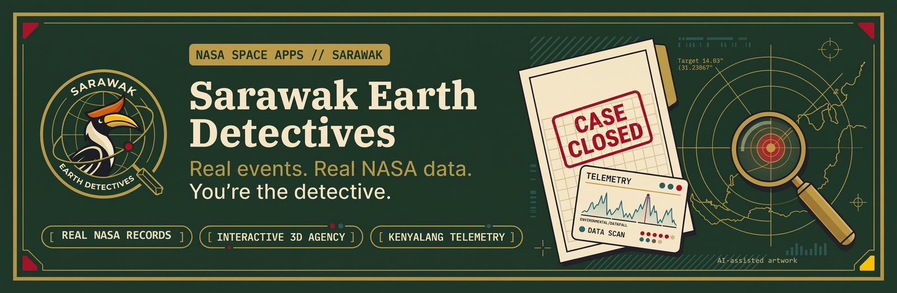

<p align="center"></p>

# Sarawak Earth Detectives

*Real events. Real NASA data. You're the detective.*

A detective agency for students. An AI "client" brings real cases about Sarawak's floods, haze, peat fires and dry spells; the student picks evidence from decades of NASA Earth data, removes the seasons, tests whether the change is real, and writes the verdict. "Not enough evidence" is a winning answer.

Built for the NASA Space Apps Challenge 2026, challenge "Be An Earth System Trend Detective!".

## Live links (no login needed)
- **Landing page:** https://ssc-workspace-2026.web.app/
- **Web app (the detective office):** https://ssc-workspace-2026.web.app/#/play
  - Opens the 3D office; small screens and devices without WebGL get the 2D lite mode, and a **2D** button switches any time.
- **Backend API (Cloud Run, for reference):** https://sed-api-f7fsjojvgq-as.a.run.app/health
- **Demo (30 s):** _link to be added_

## How it works
1. **The Call** — a case arrives. 2. **The Scene** — visit it on a map of Sarawak. 3. **The Evidence Locker** — choose measurements, reject red herrings. 4. **The Board** — see each as a time series. 5. **The Lab** — season filter, trend ruler, significance scales, El Niño lamp. 6. **The Deduction** — write the verdict. 7. **Case Closed** — the Chief's stamp, feedback and badges; solved cases are filed under Learnt cases in the inbox.

Every number comes from statistics code (OLS trend + Mann-Kendall, both must agree), never from the AI. Each record can be seen as a line chart, a year-by-month heatmap or yearly stripes; the lab adds the trend line with its 95% range, the two p-values, a shuffle-test histogram, the normal year as bars and an El Niño scatter chart. Clue pins on the map can be moved or removed at any time.

## Data
Used in the build: NASA POWER (MERRA-2: soil wetness, humidity, rain, wind), NASA GIBS (VIIRS fire detections, Blue Marble imagery), NOAA's Relative Oceanic Niño Index (RONI), and SRTM-derived terrain (AWS Terrain Tiles). Planned sources and full links: `MASTER_SHEET.md` §6–7.

## Run locally
```bash
cd backend && uv sync && uv run uvicorn app.main:app --reload --port 8000
cd frontend && npm install && npm run dev
```

## Use of AI
- **In the product:** Gemini on Vertex AI through Google's Agent Development Kit, for the Partner (hints only, guarded so it never gives the answer) and the Chief (wording the code's grade). Statistics and grading are plain code. Two more agents, the Scout and the Case Builder, draft new cases: a weekly job reads public news feeds (headline, link and date only) and checks the saved NASA records for unusual readings; code runs the checklist, picks the evidence cards and computes the answer key; Gemini only screens the headlines and writes the brief, and its text passes the same guards. Every draft waits for a human editor (`/#/review`) before students can see it. When a case is closed, a fifth agent, the Reporter, writes a formal executive summary from a facts sheet built by code; every figure must already be in that sheet, otherwise the summary is written by a code template. The student's printable case study is built by code alone. Students can hold a button to speak a question to Kenyalang instead of typing: this uses the browser's own speech recognition where there is one (in Chrome and Edge the audio goes to the browser maker's speech service). In other browsers, such as Firefox, the button records up to 20 seconds and our server asks Gemini to write down the words; the audio is not stored, only the text comes back, and it passes the Partner's guards like anything typed. The wire desk in the office (`/#/play?at=agency`) shows this activity. Case 001 was written by the team from news sources.
- **In development:** Claude Code (Anthropic) helped with planning, scaffolding and code. AI-assisted source files carry a header note.
- AI-generated images or video carry a visible watermark. No NASA logos are used.

## Team
Nathan (CEO & CTO) · Malcolm (CMO & CTO) · Zoe (CMO & Media)
